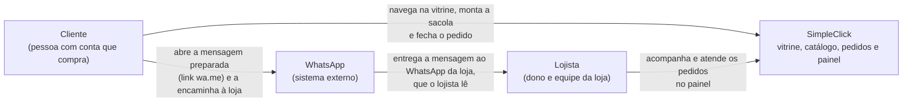
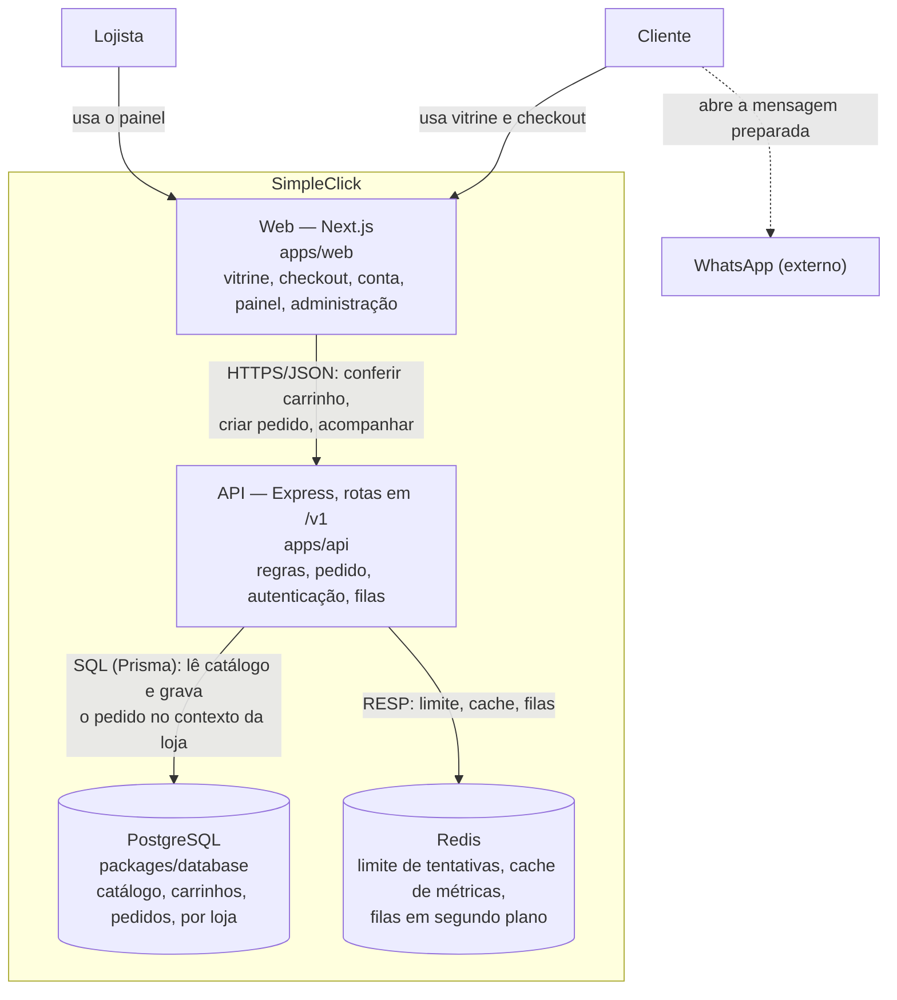

# Arquitetura do SimpleClick — C4 (contexto e contêineres)

C4 é um desenho da arquitetura em níveis. Aqui estão os dois primeiros: **contexto** (quem usa o sistema) e **contêineres** (unidades de software e de armazenamento). "Contêiner" não quer dizer Docker: é um programa que roda ou um lugar onde dados ficam.

Os caminhos de código citados foram conferidos na árvore atual (`arquivo:linha`). Linhas mudam; se uma referência não bater, procure o nome da função.

## 1. Contexto

Pontos que o desenho precisa deixar claros:

- **O SimpleClick não envia a mensagem de WhatsApp.** Ele monta o texto e o link `wa.me` (`apps/api/src/modules/orders/pedidos.routes.ts:493-508`); é o **cliente** quem abre a conversa e envia. Não há integração servidor→WhatsApp.
- O botão **"Já enviei"** só registra o que o cliente declarou: `POST /v1/vitrine/{apelido}/pedidos/{token}/whatsapp-confirmado` (`pedidos.routes.ts:637`). O primeiro registro, o do clique, é `.../whatsapp-clique` (`pedidos.routes.ts:630`). Nenhum dos dois prova que a mensagem chegou.
- Fechar pedido **exige conta** (`pedidos.routes.ts:257-267`, 401 `conta_obrigatoria`).

## 2. Contêineres

| Origem | Destino | O que acontece | Onde está no código |
|---|---|---|---|
| Cliente, lojista | Web | Cliente usa vitrine e checkout; lojista usa o painel | `apps/web/src/app/` |
| Web | API | A interface pede a conferência do carrinho e a criação do pedido | cliente HTTP em `apps/web/src/lib/carrinho-do-navegador.ts`; rotas em `apps/api/src/modules/orders/pedidos.routes.ts` (`POST /:apelido/pedidos`, linha 251) |
| API | PostgreSQL | Lê o catálogo e grava o pedido **dentro de uma transação com o contexto da loja** (`executarComoRequisicao` + `emTransacao`) | `pedidos.routes.ts:317-326`; `apps/api/src/core/db.ts` |
| API | Redis | Três usos reais, abaixo | abaixo |
| Cliente | WhatsApp | Abre a mensagem preparada; "Já enviei" registra a declaração | seção 1 |

### Usos reais do Redis

| Uso | Onde | Se o Redis cair |
|---|---|---|
| **Limite de tentativas** (script Lua atômico) para login/identidade, pareamento da impressão e catálogo público | `apps/api/src/core/limite.ts:319-322` (cliente `@redis/client`); ligado em `apps/api/src/modules/auth/servicos-da-identidade.ts:306`, `apps/api/src/modules/storefront/limite-do-catalogo.ts:44` (montado em `apps/api/src/app.ts:708`) e `apps/api/src/app.ts:579` (pareamento) | Conforme o ponto: o pareamento da impressão **fecha**, e o resto segue (comentário em `app.ts:572-574`) |
| **Cache de métricas do painel** (TTL 60 s), com cliente RESP próprio | `apps/api/src/core/cache.ts:324` (`criarClienteRedis`), `:732` (`cache()`); usado em `apps/api/src/modules/metrics/metricas.routes.ts:107,177` e `metrics/cache.ts:35` | O Redis é descartável por decisão registrada (`core/cache.ts:31`): perde-se velocidade, não dado |
| **Filas em segundo plano** (BullMQ: e-mail e remoção definitiva de lojas) | `apps/api/src/jobs/fila.ts:205-207` (Queue) e `:272-273` (Worker); montadas em `apps/api/src/main.ts:230-232` só quando `segundoPlanoLigado` (`core/env.ts:410`): ligado em produção, desligado fora dela | Tarefas em segundo plano param; pedido e vitrine não dependem delas |

O **pedido não passa pelo Redis**: preço, pedido e carrinho vivem no PostgreSQL.

### Prontidão (`/v1/health/ready`)

- `GET /v1/health/live`: o processo está de pé. `GET /v1/health/ready`: pode receber tráfego (`apps/api/src/modules/health/health.routes.ts:39`, `:218`).
- `ready` verifica **PostgreSQL e Redis em paralelo**, cada um com tempo máximo (`health.routes.ts:171-181`). O banco é testado com `SELECT 1` pelo mesmo caminho que a API usa (`:112-125`); o Redis por `cacheResponde` em `health/health.cache.ts`, via `cacheDisponivel` (`:141`) e `REDIS_URL`.
- Resposta: `200` com `{ pronto: true, dependencias: { banco: "ok", cache: "ok" } }`; `503` (`STATUS_NAO_PRONTO`, `:196`) se qualquer um estiver `indisponivel`. A resposta não revela nome de máquina nem credencial; o detalhe vai só para o log.
- **Consequência:** com o Redis fora, `/ready` dá 503 mesmo que o pedido não use Redis. É escolha da prontidão atual (exige as duas dependências), não do fluxo de compra.

## 3. Quem faz o quê na compra (resumo para quem chegou agora)

| Pergunta | Resposta | Onde |
|---|---|---|
| Quem calcula o preço? | O servidor, a partir do catálogo. O total que a tela mostra serve só para registrar divergência | `conferirCarrinho` em `packages/core/src/pedido-total.ts:192`; taxa e total em `calcularValores`, `packages/core/src/taxa-entrega.ts:170`; chamadas em `pedidos.routes.ts:336-350` |
| Quem grava a compra? | A rota `POST /v1/vitrine/{apelido}/pedidos`, numa única transação: pedido, baixa de estoque e conversão do carrinho | `pedidos.routes.ts:326-460`; `criarPedido` (`orders/criar-pedido.usecase.ts:284`); `converterCarrinhoNoPedido` (`orders/pedido-fechado.usecase.ts:45`) |
| De onde vem a resposta a um reenvio? | Do pedido **guardado** no banco, achado pela chave de idempotência; nunca do carrinho (que já foi convertido) | `pedidoDaChaveDeFechamento` (`pedido-fechado.usecase.ts:26`), usado em `pedidos.routes.ts:330-334`; resposta 200 em `:463-473` |

Decisão detalhada: [ADR 0001](../adr/0001-pedido-e-carrinho-na-mesma-transacao.md). Contrato dos dois endpoints: [openapi-pedidos.yaml](openapi-pedidos.yaml).
